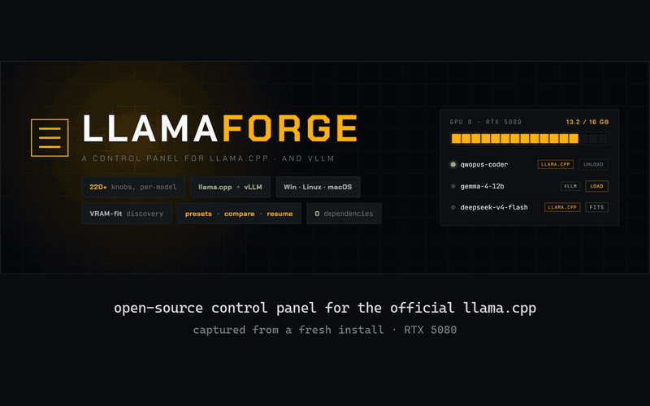
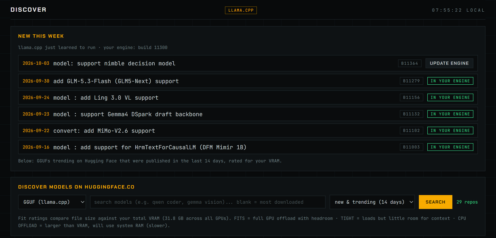
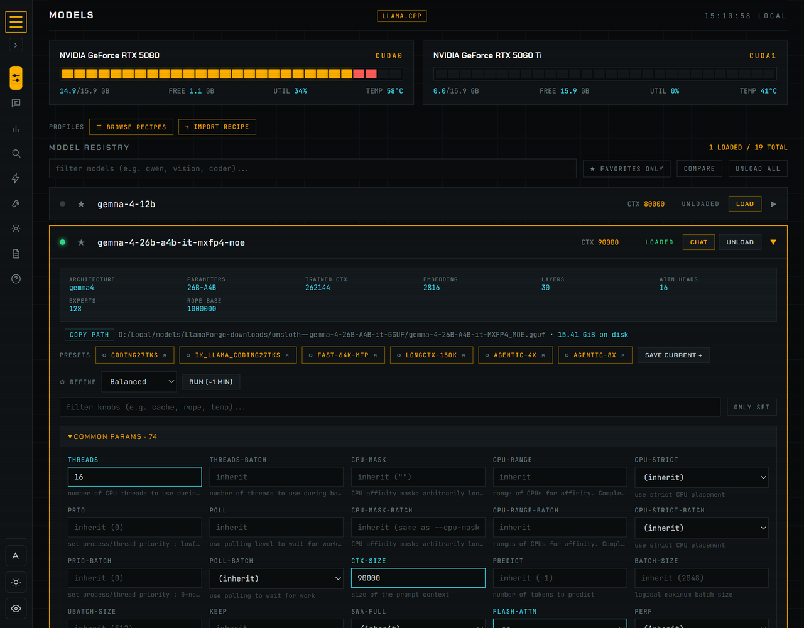
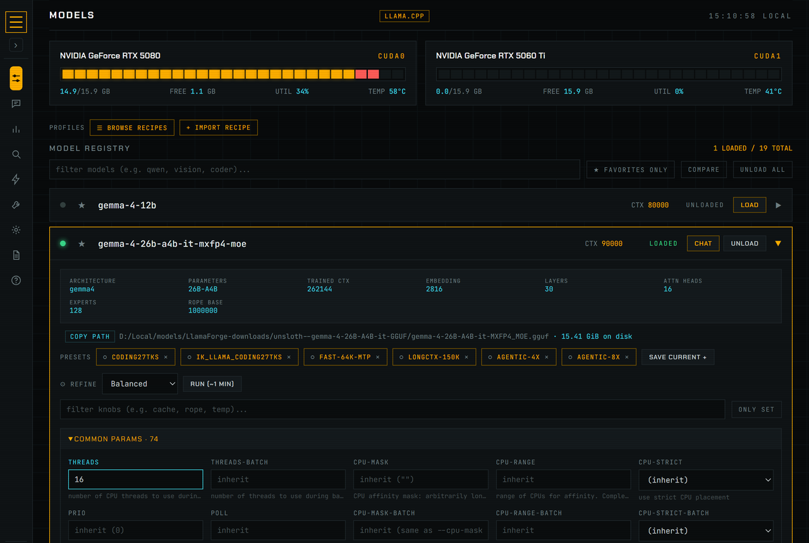
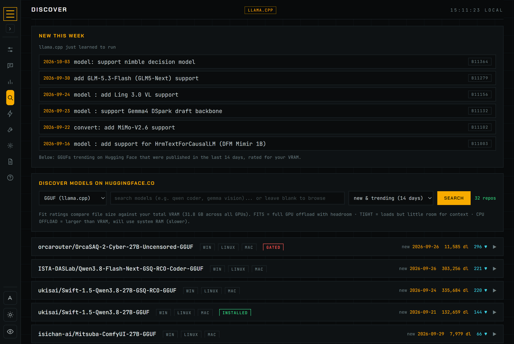
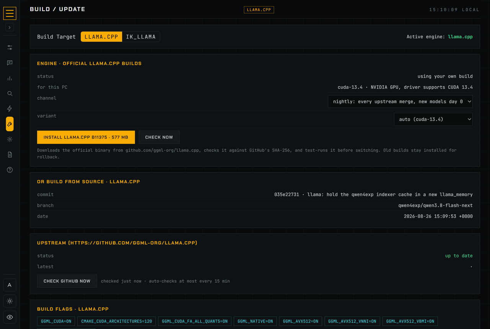

<p align="center">
  
</p>

<h1 align="center">LlamaForge</h1>

<p align="center"><b>The real llama.cpp server, run from a browser tab.</b><br>
Pick a model, see if it fits your GPU, load it, chat. Every llama-server flag is still there when you want it.</p>

<p align="center">
  <a href="https://github.com/dadwritestech/LlamaForge/actions/workflows/ci.yml"></a>
  <a href="LICENSE"></a>
  
  <a href="https://github.com/dadwritestech/LlamaForge/stargazers"></a>
  <a href="docs/mascot/llamaforge-mascot.png"></a>
</p>

<p align="center"><sub>🎉 100 stars. Thank you! <a href="#star-history">Who got it here</a> · <a href="ROADMAP.md">what's next</a></sub></p>

```powershell
irm https://raw.githubusercontent.com/dadwritestech/LlamaForge/master/install.ps1 | iex   # Windows, no admin
```
```bash
curl -fsSL https://raw.githubusercontent.com/dadwritestech/LlamaForge/master/install.sh | sh   # Linux / macOS
```
Then **Install llama.cpp** (the official build for your GPU, no compiler) → **Discover** → **Chat**.
Early preview: Windows + NVIDIA is the most-tested path. Linux and macOS pass CI but have had little real-hardware use.

<p align="center">
  
</p>

LlamaForge runs no models itself. It installs and drives llama.cpp's own `llama-server` router and
edits its `models.ini` for you. Not affiliated with ggml-org. If you'd rather have polish than
control, use [LM Studio](https://lmstudio.ai), [Ollama](https://ollama.com) or [Jan](https://jan.ai).

## Why LlamaForge

New model architectures land in llama.cpp first. Desktop apps pass them on when they next
update their bundled engine. LlamaForge runs the **official llama.cpp release itself** (or
your own build or fork), so a new model is one **Update** click away, and it puts a UI over
every server flag instead of a curated subset.

<p align="center">
  
  <br><sub>Discover opens on what llama.cpp just learned to run, checked against the engine you have.</sub>
</p>

| | **LlamaForge** | LM Studio | Ollama |
|---|---|---|---|
| Open source | ✅ MIT | ❌ proprietary app | ✅ MIT |
| Engine | official upstream llama.cpp builds, any version, or your own fork | LM Studio's bundled llama.cpp / MLX runtimes | Ollama's own engine on ggml |
| Per-model settings | every flag your `llama-server --help` lists (200+ on current builds) | many, curated | Modelfile parameters |
| Any GGUF from Hugging Face, rated for your VRAM before download | ✅ (a rough estimate) | ✅ | pulls GGUFs, no fit rating |
| OpenAI + Anthropic-compatible API | ✅, plus one-click Claude Code / Codex / pi.dev config | ✅ | ✅ |
| Backend dependencies | none (Python stdlib) | – | – |
| Native desktop app | ❌ runs in your browser | ✅ | ✅ |
| Maturity | **early preview** | mature | mature |

<sub>As of October 2026, to the best of our knowledge. Spot something wrong? A PR to fix this table is very welcome.</sub>

## What's in it

- **Models**: every model on your machine in one list, with live VRAM/util/temp per GPU. Load, unload, or open Chat from the row.
  - Expand a model to edit every llama-server flag, grouped and searchable, next to a GGUF metadata card (architecture, quant, trained context, layers).
  - Save reloads the model in place. A failed load shows the last error from the router log with a best-guess hint.
  - A loading model shows real progress (weights, draft, vision), straight from llama.cpp's load callback. One-click switches for **Thinking** (Auto / On / Off plus a token budget, with a note on whether the model's chat template can really turn it off) and **Vision** (off frees the projector's VRAM; the file stays on disk).
  - Presets, launch profiles (model + preset + pinned llama.cpp build in one click), side-by-side compare, and copy-paste client snippets.
  - **Game mode** unloads your models when a game starts and loads them again when it closes; pick any to keep loaded.
  - **Elastic VRAM** (new in v0.16.4, off by default; NVIDIA): when another app needs the GPU, a loaded model moves layers to the CPU instead of unloading, keeps its conversation, and moves back once the memory is free. Slower while it's shrunk.
  - Turn on **Multi-model** in Setup to keep a main model and workers loaded at once. A planner places each one on the GPUs that fit it, using footprints measured on your machine. A model can also be pinned to its own llama.cpp (or ik_llama.cpp) build.
- **Chat**: llama.cpp's own chat UI (markdown, reasoning, images) inside the dashboard, on its own port, with the API key added for you.
- **Voice**: text to speech on your GPU through llama.cpp's own `llama-tts`: Qwen3-TTS in 10 languages, or the tiny English Pocket TTS that runs faster than real time even on a CPU, optionally in a voice you record or upload (only clone voices you may use).
- **Embers**: small local agents that keep watch on a topic, keep their own wiki and write you a brief on a schedule. A wiki item only counts if it quotes its source verbatim. **Forge** builds one by interviewing you; **Model Scout** needs no setup. Embers have no browser or tools, and nothing leaves the machine unless you turn on push notifications.
- **Discover**: Hugging Face GGUF search that opens on what's new this week. Every quant gets a rough fit rating for your VRAM before you download (FITS / TIGHT / CPU OFFLOAD). Downloads resume after interruption, register themselves, and end in **Load & Chat**.
- **Will it run?**: pick a repo and quant, get the fit and a rough speed estimate.
- **Build / Update**: one-click official llama.cpp builds with rollback, or build from source with flags detected for your GPU. Also drives [ik_llama.cpp](https://github.com/ikawrakow/ik_llama.cpp) and, on Windows, [vLLM](https://github.com/vllm-project/vllm) in WSL2.
- **Stats**: per-model tokens, speed and run counts from the router's own metrics, plus live GPU memory and system RAM. Per-client stats aren't possible, because clients talk to the router directly.
- **Context**: Markdown context docs composed into profiles, injected into requests or written into `CLAUDE.md` / `AGENTS.md`.
- **Recipes**: share a profile as readable JSON; others import it in one paste and LlamaForge downloads the model if missing. There's a [community gallery](recipes/).

A first-run wizard and a **Lite / Advanced** toggle keep the deep knobs out of the way until you want them. The default look, **Stowage**, draws each GPU as a bay plan ruled in 1 GiB cells; **Hearth** and **Classic** are one click away, and each comes in light, dark and colorblind-safe.

## Use it from other apps

Anything that speaks the OpenAI API (Open WebUI, SillyTavern, Continue, Cline, Aider, the OpenAI SDKs) works against
`http://127.0.0.1:8080/v1`. The router always runs with an API key, and **Client Config** on any model gives you the
base URL, key and model id ready to paste.

- **Anthropic-compatible** `POST /v1/messages` on the panel, with streaming and tool use.
- **OpenAI speech-compatible** `POST /v1/audio/speech` on the panel (WAV or PCM), backed by `llama-tts`.
- **Connect an agent** writes the config for **Claude Code**, **Codex** and **pi.dev** (any file it touches is backed up first).
- Load/unload endpoints let an agent swap models on demand.
- **MCP server** (stdio, `backend/mcp_server.py`): Claude Code, Codex or any MCP client can see what's loaded,
  load and unload models, check what fits, pull GGUFs from Hugging Face, and hand a whole task to
  [pi](https://github.com/earendil-works/pi) running on a loaded local model (`pi_run`). One-line setup under
  **Setup -> MCP server**, e.g. `claude mcp add --scope user llamaforge -- python <LlamaForge>/backend/mcp_server.py`.

## Screenshots

| Models: each GPU drawn to scale, with the open model booked in | Stats: memory and live speed per model |
|---|---|
|  |  |

| Discover: new in llama.cpp, then trending GGUFs | Build / Update |
|---|---|
|  |  |

## Install

The one-liners above need no git, admin or compiler. Re-run them any time to update.

The installer finds Python 3.10+ (on Windows it drops a private, SHA-256-pinned copy of
python.org's embeddable Python if you have none), downloads the latest release, adds a
Start menu / app-menu entry (`~/Applications/LlamaForge.app` on macOS, plus a `llamaforge`
command on Linux/macOS) and opens the dashboard. Updating keeps your settings, models and
engines. Uninstall from **Apps & Features** on Windows, or `llamaforge uninstall`; it asks
before touching your settings or models.

<details><summary>From source (git clone)</summary>

```powershell
git clone https://github.com/dadwritestech/LlamaForge
cd LlamaForge
powershell -ExecutionPolicy Bypass -File bootstrap.ps1   # Windows
./bootstrap.sh                                           # Linux / macOS
```

The bootstrap script checks for Python and Git (asking before installing anything),
writes `config.json` and opens the dashboard.
</details>

**Daily use:** open **LlamaForge** from the Start menu / app menu, or run `llamaforge`.
It starts the router and the dashboard and opens your browser.

- Dashboard: http://127.0.0.1:8090
- Chat: http://127.0.0.1:8091 (also the dashboard's **Chat** tab)
- API for your other apps: http://127.0.0.1:8080/v1

`llamaforge stop` (or `stop.ps1` / `stop.sh`) shuts down the dashboard, the router and
the models it spawned. It stops only processes LlamaForge started; any other
llama-server you run is left alone.

**Requirements:** Windows 10/11, Linux, or macOS on Apple Silicon. Python 3.10+ (stdlib only;
the Windows installer brings its own). NVIDIA (CUDA), AMD/Intel (Vulkan) or Apple (Metal) GPUs
run models when present; CPU-only works. The VRAM preview, fit ratings and GPU stats read
NVIDIA and Apple memory today; AMD/Intel cards don't show VRAM in the panel yet. Building from source also needs Git, CMake, Ninja and
a C++ compiler, which the Setup tab can install where a package manager allows.

## How it works

LlamaForge contains no llama.cpp code. A pure-stdlib Python backend drives llama.cpp's own
router API, edits `models.ini`, and fetches official builds (or shells out to `git` / `cmake`).
The knob list is parsed live from `llama-server --help`, so it tracks whatever build you run.

LlamaForge doesn't pin context size, GPU layers or the multi-GPU split. llama.cpp's `--fit`
(on by default) sizes all three to your free VRAM at load, and moves MoE experts to CPU when
needed. Pinning any of them turns fit off, so they stay unset unless you set them yourself.

**Security:** the dashboard only listens on `127.0.0.1`. The router is keyed even when
local, so a web page you visit can't drive it. LAN access is opt-in from Setup and always
needs a key. Details and how to report a vulnerability privately: [SECURITY.md](SECURITY.md).

## Docs

Everything is in the in-app **Help** tab and at **[dadwritestech.github.io/LlamaForge](https://dadwritestech.github.io/LlamaForge/)**:
[configuration](docs/content/config.md), [keyboard shortcuts](docs/content/keymap.md),
[themes & colorblind-safe mode](docs/content/theming.md), [vLLM](docs/content/vllm.md),
[troubleshooting](docs/content/troubleshooting.md), and [what's new](docs/content/whats-new.md).
[ROADMAP.md](ROADMAP.md) has what's shipped and planned; it's an early preview, so priorities follow feedback.

## Star history

100 stars in about three months, for a solo, heavily AI-assisted side project. Thank you.

Bug reports, ideas and code from [@Vergillll](https://github.com/Vergillll),
[@Alihkhawaher](https://github.com/Alihkhawaher), [@BenjaminBilbro](https://github.com/BenjaminBilbro),
[@BrethofAI](https://github.com/BrethofAI), [@CaspervanWetten](https://github.com/CaspervanWetten),
[@FLOATING-POINT](https://github.com/FLOATING-POINT), [@Katchyuser](https://github.com/Katchyuser),
[@jay23606](https://github.com/jay23606), [@mikinko](https://github.com/mikinko) and
[@tmill328](https://github.com/tmill328) shaped what's here. If you've filed an issue, you're part of this.

<a href="https://star-history.com/#dadwritestech/LlamaForge&Date">
  
</a>

## Credits & license

LlamaForge is MIT-licensed ([LICENSE](LICENSE)). It builds and drives
**[llama.cpp](https://github.com/ggml-org/llama.cpp)** - MIT, (c) The ggml authors -
see [NOTICE](NOTICE) and [LICENSE.llama.cpp.txt](LICENSE.llama.cpp.txt).
The hard part is theirs; please star and support the upstream project.

`pi_run` drives **[pi](https://github.com/earendil-works/pi)**, Mario Zechner's open-source coding agent (MIT).
LlamaForge doesn't ship it: **Setup → Install pi** fetches the published npm package into
LlamaForge's own `agents/` folder using your Node.js (or install it yourself with
`npm install -g @earendil-works/pi-coding-agent`).
