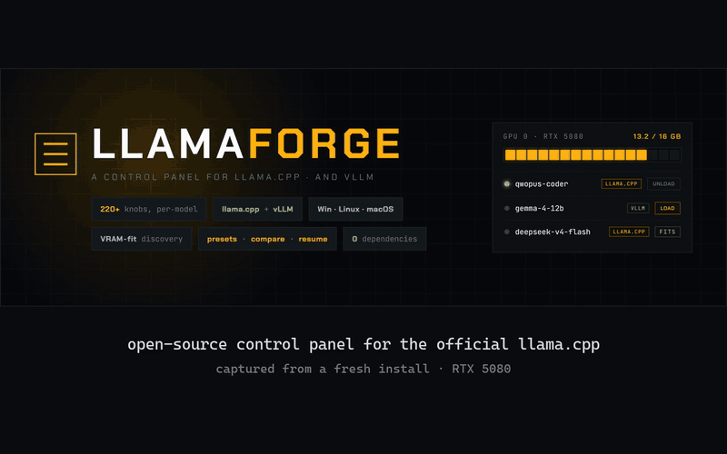
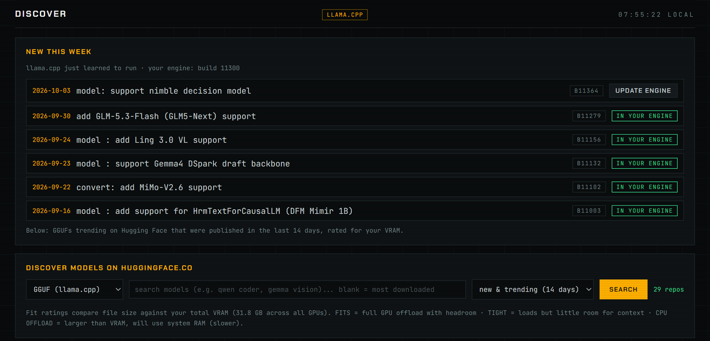
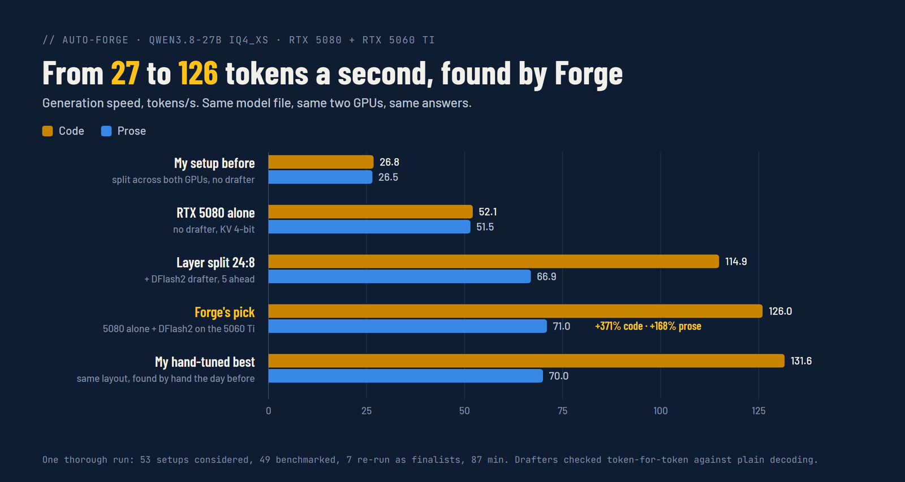
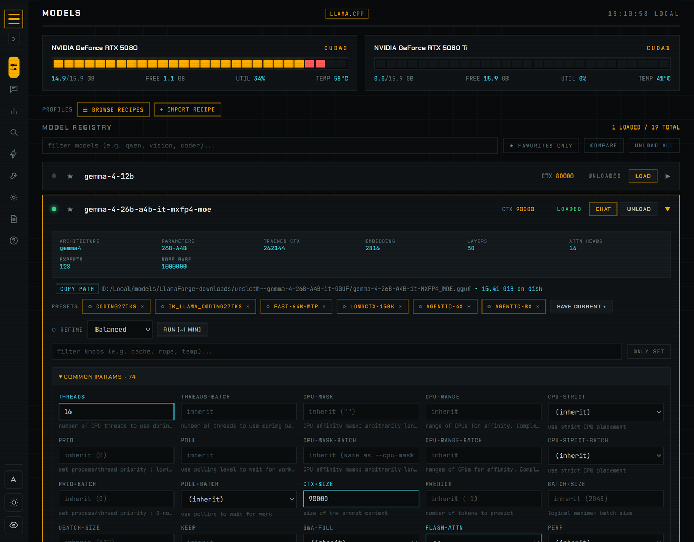
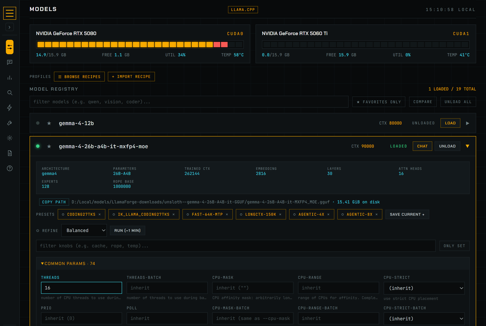
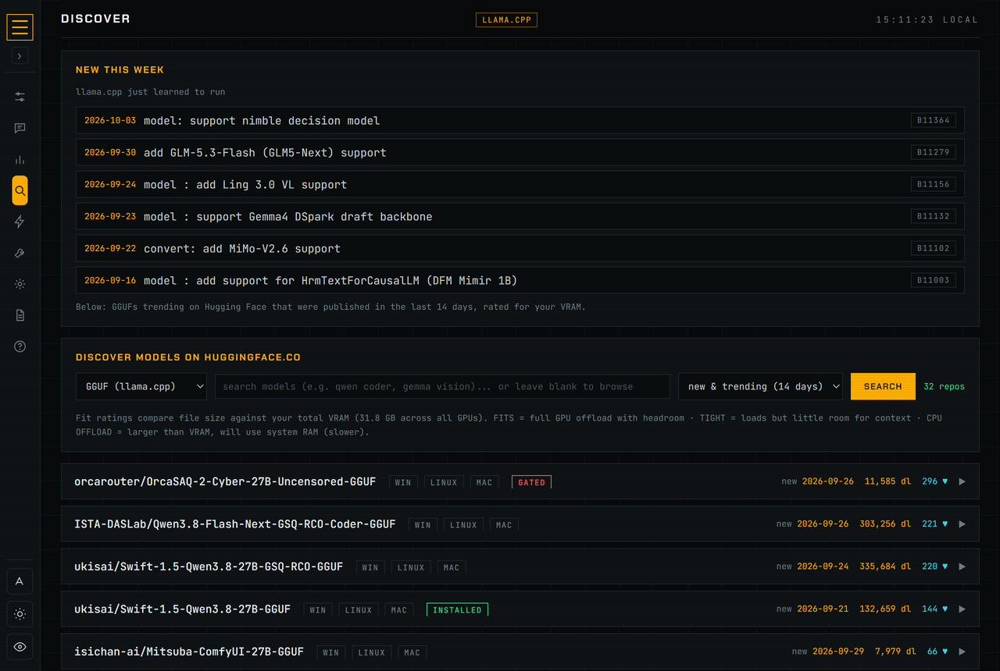
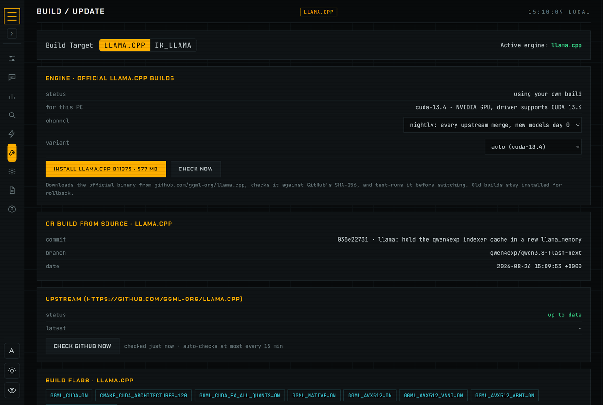

<p align="center">
  
</p>

<h1 align="center">LlamaForge</h1>

<p align="center"><a href="README.md">English</a> · <b>简体中文</b></p>

<p align="center"><b>在浏览器标签页里运行真正的 llama.cpp 服务器。</b><br>
选模型，看它能不能放进你的显卡，加载，开聊。需要时，llama-server 的每一个参数都还在。</p>

<p align="center"><a href="docs/content/autoforge.md"><b>Auto-Forge</b></a> 在你自己的显卡上实测各种参数组合并保留最快的：在作者的机器上，一个 Qwen3.8-27B 写代码从 <b>26.8 提到 126 tokens/s</b>。<br>
<b>已经在用 Ollama？</b> 你下载过的模型可以原地跑在上游 llama.cpp 上，不用重新下载。</p>

> 本页由机器翻译并经人工整理，以 [英文 README](README.md) 为准。界面目前只有英文，下文的按钮和菜单名保留英文原文。
> 欢迎母语用户指正：直接提 PR 修改本文件即可。

```powershell
irm https://raw.githubusercontent.com/dadwritestech/LlamaForge/master/install.ps1 | iex   # Windows，无需管理员
```
```bash
curl -fsSL https://raw.githubusercontent.com/dadwritestech/LlamaForge/master/install.sh | sh   # Linux / macOS
```
然后依次点 **Install llama.cpp**（为你的显卡下载官方构建，无需编译器）→ **Discover** → **Chat**。
早期预览版：Windows + NVIDIA 是测试最充分的组合。Linux 和 macOS 通过了 CI，但真实硬件上用得还不多。

<p align="center">
  
</p>

LlamaForge 自己不运行任何模型。它负责安装并驱动 llama.cpp 自带的 `llama-server` 路由器（router），
并替你编辑它的 `models.ini`。与 ggml-org 无隶属关系。如果你更想要打磨好的体验而不是完全的控制权，
可以用 [LM Studio](https://lmstudio.ai)、[Ollama](https://ollama.com) 或 [Jan](https://jan.ai)。

## 为什么用 LlamaForge

新的模型架构总是先进入 llama.cpp，桌面应用要等下次更新内置引擎才能跟上。
LlamaForge 直接运行 **llama.cpp 官方发布版本**（也可以是你自己的构建或分支），
新模型只差一次 **Update** 点击；而且它给服务器的每一个参数都做了界面，而不是挑一部分。

<p align="center">
  
  <br><sub>Discover 一打开就是 llama.cpp 刚学会运行的模型，并对照你手上的引擎版本检查。</sub>
</p>

| | **LlamaForge** | LM Studio | Ollama |
|---|---|---|---|
| 开源 | ✅ MIT | ❌ 闭源应用 | ✅ MIT |
| 引擎 | 上游 llama.cpp 官方构建，任意版本，或你自己的分支 | LM Studio 内置的 llama.cpp / MLX 运行时 | Ollama 基于 ggml 的自有引擎 |
| 单模型设置 | 你的 `llama-server --help` 列出的每个参数（当前构建 200+） | 很多，精选 | Modelfile 参数 |
| Hugging Face 上任意 GGUF，下载前按你的显存评估 | ✅（粗略估计） | ✅ | 可拉取 GGUF，无适配评估 |
| OpenAI + Anthropic 兼容 API | ✅，另有 Claude Code / Codex / pi.dev 一键配置 | ✅ | ✅ |
| 后端依赖 | 无（仅 Python 标准库） | – | – |
| 原生桌面应用 | ❌ 在浏览器里运行 | ✅ | ✅ |
| 成熟度 | **早期预览** | 成熟 | 成熟 |

<sub>截至 2026 年 10 月，就我们所知。发现有误？非常欢迎提 PR 修正这张表。</sub>

## 功能一览

- **Models**：本机所有模型在一个列表里，每块显卡实时显示显存/利用率/温度。在行内加载、卸载或打开聊天。**已经有 Ollama？** 扫描会找到它下载的模型，并用 llama.cpp 运行同一批文件，不做任何复制。
  - 展开模型即可编辑 llama-server 的所有参数（分组、可搜索），旁边是 GGUF 元数据卡片（架构、量化、训练上下文、层数）。
  - 保存后原地重载模型。加载失败时显示路由器日志里的最后一条错误，并给出推测的解决办法。
  - 加载中的模型显示真实进度（权重、草稿模型、视觉投影），直接来自 llama.cpp 的加载回调。**Thinking**（Auto / On / Off，可设 token 预算，并提示模型的聊天模板能否真正关闭思考）和 **Vision**（关闭可释放投影器占用的显存，文件仍留在磁盘上）一键切换。
  - 预设、启动配置（模型 + 预设 + 固定的 llama.cpp 构建，一键启动）、并排对比，以及可直接复制的客户端代码片段。
  - **Game mode**：游戏启动时卸载模型，游戏关闭后重新加载；可以选择保留哪些。
  - **Elastic VRAM**（默认关闭；仅 NVIDIA）：其他程序需要显卡时，已加载的模型把部分层挪到 CPU，而不是直接卸载，对话得以保留；显存空出来后再挪回去。缩小期间速度会变慢。
  - **Auto-Forge**（v0.17.0 新增；仅 NVIDIA）：通过实测为你的显卡找出运行某个模型最快的方式。它在沙盒里尝试不同的放置方式、KV 缓存类型和推测解码草稿模型，检查草稿模型给出的答案是否一致，然后把最优方案写入 `models.ini`，可一键撤销。在作者的机器上，它把一个 Qwen3.8-27B 写代码的速度从 26.8 tokens/s（大部分在较慢的显卡上）提到 126.0，是最佳普通配置的 2.4 倍。**Share** 可以把结果生成图片卡片和 Markdown 表格，不含路径、密钥或主机名。[工作原理](docs/content/autoforge.md)。

    

  - 在 Setup 里打开 **Multi-model**，可以同时保持一个主模型和若干工作模型加载。规划器根据在你机器上实测的占用，把每个模型放到放得下的显卡上。模型也可以固定到它自己的 llama.cpp（或 ik_llama.cpp）构建。
- **Chat**：llama.cpp 自带的聊天界面（Markdown、推理过程、图片），嵌在面板里，运行在独立端口，API 密钥已自动带上。
- **Voice**：通过 llama.cpp 自带的 `llama-tts` 在显卡上做文字转语音：支持 10 种语言的 Qwen3-TTS，或小巧的英文 Pocket TTS（即使在 CPU 上也快于实时），可以用你录制或上传的声音（只克隆你有权使用的声音）。
- **Embers**：小型本地智能体，盯住一个话题，维护自己的 wiki，并定时给你写简报。wiki 条目必须逐字引用来源才算数。**Forge** 通过向你提问来创建一个 Ember；**Model Scout** 无需配置。Ember 没有浏览器也没有工具，除非你打开推送通知，否则没有任何数据离开本机。
- **Discover**：Hugging Face GGUF 搜索，打开就是本周新增。每个量化版本在下载前都会按你的显存给出粗略评级（FITS / TIGHT / CPU OFFLOAD）。下载可断点续传，完成后自动注册，最后一步是 **Load & Chat**。形如 `http://127.0.0.1:8090/#discover?repo=owner/name&file=x.gguf` 的链接会直接打开某个量化版本。
- **Will it run?**：选一个仓库和量化版本，得到适配情况和粗略的速度估计。
- **Build / Update**：一键安装官方 llama.cpp 构建并可回滚，或按检测到的显卡参数从源码编译。也能驱动 [ik_llama.cpp](https://github.com/ikawrakow/ik_llama.cpp)，以及 Windows 上 WSL2 里的 [vLLM](https://github.com/vllm-project/vllm)。
- **Stats**：来自路由器自身指标的每个模型的 token 数、速度和运行次数，以及实时显存和系统内存。无法按客户端统计，因为客户端直接和路由器通信。
- **Context**：Markdown 上下文文档组合成配置，注入请求或写进 `CLAUDE.md` / `AGENTS.md`。
- **Recipes**：把一个启动配置分享为可读的 JSON；别人粘贴一次即可导入，缺少的模型 LlamaForge 会自动下载。另有[社区合集](recipes/)。

首次运行向导和 **Lite / Advanced** 开关会把深层设置收起来，等你需要时再出现。默认外观 **Stowage** 把每块显卡画成以 1 GiB 为格的舱位图；**Hearth** 和 **Classic** 一键可换，每种都有浅色、深色和色盲友好模式。

## 从其他应用使用

任何支持 OpenAI API 的工具（Open WebUI、SillyTavern、Continue、Cline、Aider、OpenAI SDK）都可以连到
`http://127.0.0.1:8080/v1`。路由器始终带 API 密钥运行，任意模型上的 **Client Config** 会给出可直接粘贴的
base URL、密钥和模型 ID，以及为 Open WebUI（含 Docker 地址）、Continue 的 `config.yaml`、Cline 和 `aider` 命令填好的设置。

嵌入（embedding）和重排序（reranker）GGUF 会从文件头识别出来，标记为 **embed** 或 **rerank**，并以
`--embeddings` 或 `--reranking` 启动。它们的 Client Config 给出 `/v1/embeddings` 或 `/v1/rerank` 请求，以及用于 RAG 的
Open WebUI **Documents** 设置。

- 面板上提供 **Anthropic 兼容**的 `POST /v1/messages`，支持流式输出和工具调用。
- 面板上提供 **OpenAI 语音兼容**的 `POST /v1/audio/speech`（WAV 或 PCM），由 `llama-tts` 驱动。
- **Connect an agent** 为 **Claude Code**、**Codex** 和 **pi.dev** 写好配置（改动的任何文件都会先备份）。
- 加载/卸载接口让智能体可以按需切换模型。
- **MCP 服务器**（stdio，`backend/mcp_server.py`）：Claude Code、Codex 或任何 MCP 客户端都能查看已加载的模型、
  加载和卸载模型、检查是否放得下、从 Hugging Face 拉取 GGUF，还能把整个任务交给运行在本地模型上的
  [pi](https://github.com/earendil-works/pi)（`pi_run`）。在 **Setup -> MCP server** 下一行命令即可配置，例如
  `claude mcp add --scope user llamaforge -- python <LlamaForge>/backend/mcp_server.py`。

## 截图

| Models：每块显卡按比例绘制，已打开的模型占好位置 | Stats：每个模型的内存和实时速度 |
|---|---|
|  |  |

| Discover：llama.cpp 新增，然后是热门 GGUF | Build / Update |
|---|---|
|  |  |

## 安装

上面的一行命令不需要 git、管理员权限或编译器。随时重新运行即可更新。

安装脚本会找到 Python 3.10+（Windows 上如果没有，会放置一份私有的、SHA-256 校验过的
python.org 嵌入式 Python），下载最新版本，添加开始菜单/应用菜单入口（macOS 上是 `~/Applications/LlamaForge.app`，
Linux/macOS 上还有 `llamaforge` 命令），然后打开面板。更新会保留你的设置、模型和引擎。
在 Windows 上从 **应用和功能** 卸载，或运行 `llamaforge uninstall`；动你的设置或模型之前它会先询问。

<details><summary>从源码安装（git clone）</summary>

```powershell
git clone https://github.com/dadwritestech/LlamaForge
cd LlamaForge
powershell -ExecutionPolicy Bypass -File bootstrap.ps1   # Windows
./bootstrap.sh                                           # Linux / macOS
```

bootstrap 脚本会检查 Python 和 Git（安装任何东西之前都会先询问），写入 `config.json` 并打开面板。
</details>

**日常使用：** 从开始菜单/应用菜单打开 **LlamaForge**，或运行 `llamaforge`。
它会启动路由器和面板，并打开浏览器。

- 面板：http://127.0.0.1:8090
- 聊天：http://127.0.0.1:8091（也是面板里的 **Chat** 标签页）
- 给其他应用用的 API：http://127.0.0.1:8080/v1

`llamaforge stop`（或 `stop.ps1` / `stop.sh`）会关闭面板、路由器以及它启动的模型。
它只停止 LlamaForge 自己启动的进程；你另外运行的 llama-server 不受影响。

想在登录时自动运行（比如一台常开、给 Open WebUI 用的机器）？
在 Linux（systemd 用户单元）或 macOS（launch agent）上运行 `llamaforge service on`；
`llamaforge service off` 移除。默认不开启。

**系统要求：** Windows 10/11、Linux，或 Apple Silicon 的 macOS。Python 3.10+（仅标准库；
Windows 安装器自带）。有 NVIDIA（CUDA）、AMD/Intel（Vulkan）或 Apple（Metal）显卡时用显卡运行模型；纯 CPU 也可以。
显存预览、适配评级和显卡统计读取 NVIDIA 和 Apple 的内存；AMD/Intel 显卡显示 llama.cpp 自己的设备列表报告的
总显存和已用显存（需要 Vulkan、ROCm 或 SYCL 构建；Linux 上在安装之前通过 AMD sysfs 读取），不含利用率和温度。
尚未在真实的 AMD/Intel 硬件上测试。从源码编译还需要 Git、CMake、Ninja 和 C++ 编译器，
在包管理器允许的情况下，Setup 标签页可以帮你安装。

## 工作原理

LlamaForge 不包含任何 llama.cpp 代码。一个纯标准库的 Python 后端驱动 llama.cpp 自己的
路由器 API、编辑 `models.ini`、获取官方构建（或调用 `git` / `cmake`）。
参数列表是实时从 `llama-server --help` 解析的，所以无论你运行哪个构建都能跟上。

LlamaForge 不固定上下文大小、GPU 层数或多卡切分。llama.cpp 的 `--fit`（默认开启）会在加载时
按你的空闲显存自动决定这三项，必要时把 MoE 专家挪到 CPU。固定其中任何一项都会关闭 fit，
所以除非你自己设置，它们都保持未设置。

**安全：** 面板只监听 `127.0.0.1`。路由器即使在本地也需要密钥，因此你访问的网页无法驱动它。
局域网访问需要在 Setup 里主动开启，并且始终需要密钥。详情以及如何私下报告漏洞：[SECURITY.md](SECURITY.md)。

**没有屏幕的显卡主机：** 通过 SSH 用 `./run.sh` 启动，它会打印出要在你自己电脑上运行的隧道命令
（`ssh -N -L 8090:127.0.0.1:8090 you@box`），然后在本地打开 `http://127.0.0.1:8090`。面板始终不需要监听网络。

## 文档

所有文档都在应用内的 **Help** 标签页，以及 **[dadwritestech.github.io/LlamaForge](https://dadwritestech.github.io/LlamaForge/)**（英文）：
[配置](docs/content/config.md)、[快捷键](docs/content/keymap.md)、
[主题与色盲友好模式](docs/content/theming.md)、[Auto-Forge](docs/content/autoforge.md)、[vLLM](docs/content/vllm.md)、
[故障排查](docs/content/troubleshooting.md)，以及[更新日志](docs/content/whats-new.md)。
[ROADMAP.md](ROADMAP.md) 列出已发布和计划中的内容；这是早期预览版，优先级跟着反馈走。

## Star 历史

一个人做的、大量借助 AI 的业余项目，大约三个月拿到 100 个 star。谢谢大家。

[@Vergillll](https://github.com/Vergillll)、[@Alihkhawaher](https://github.com/Alihkhawaher)、[@BenjaminBilbro](https://github.com/BenjaminBilbro)、
[@BrethofAI](https://github.com/BrethofAI)、[@CaspervanWetten](https://github.com/CaspervanWetten)、
[@FLOATING-POINT](https://github.com/FLOATING-POINT)、[@Katchyuser](https://github.com/Katchyuser)、
[@jay23606](https://github.com/jay23606)、[@mikinko](https://github.com/mikinko) 和
[@tmill328](https://github.com/tmill328) 的问题反馈、想法和代码塑造了现在的样子。只要你提过 issue，你就是其中一员。

<a href="https://star-history.com/#dadwritestech/LlamaForge&Date">
  
</a>

## 致谢与许可证

LlamaForge 采用 MIT 许可证（[LICENSE](LICENSE)）。它构建并驱动
**[llama.cpp](https://github.com/ggml-org/llama.cpp)**（MIT，(c) The ggml authors），
见 [NOTICE](NOTICE) 和 [LICENSE.llama.cpp.txt](LICENSE.llama.cpp.txt)。
真正难的部分是他们做的；请给上游项目点 star 并支持他们。

`pi_run` 驱动的是 **[pi](https://github.com/earendil-works/pi)**，Mario Zechner 的开源编程智能体（MIT）。
LlamaForge 不附带它：**Setup → Install pi** 会用你的 Node.js 把已发布的 npm 包装到
LlamaForge 自己的 `agents/` 文件夹里（也可以自己运行 `npm install -g @earendil-works/pi-coding-agent` 安装）。
